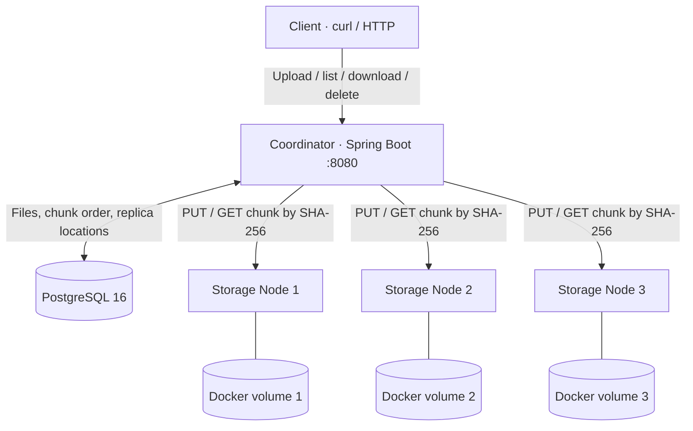

<div align="center">

# ☁️ CloudBox
### Distributed File Storage System

**Chunking · Replication · Content Integrity · Fault-Tolerant Retrieval**

Java 21 · Spring Boot · PostgreSQL 16 · Docker Compose · JUnit 5

[](https://github.com/jadu12git/cloud-box/actions/workflows/ci.yml)
[](pom.xml)
[](docker-compose.yml)
[](#scope-and-trade-offs)

</div>

> **CloudBox** is a Java-based distributed file storage prototype that breaks uploads into chunks, stores two replicas of each chunk across separate storage nodes, and reconstructs files with SHA-256 integrity verification and fallback reads. PostgreSQL tracks file metadata, chunk order, and replica locations.
>
> **Verified locally:** 11/11 JUnit tests and the live Docker/PostgreSQL integration suite passed on October 23, 2026. This is an observed local result, not a claim that every subsequent GitHub Actions run passed.

## Why I built it

Saving a file on one machine is easy; keeping it retrievable when a machine becomes unavailable is harder. CloudBox explores the storage-engineering questions behind that problem:

- How do we split and reassemble files without changing their bytes?
- How can replicas improve availability when a storage node goes down?
- How do we detect corrupted chunks rather than returning broken data?
- Where should file and replica metadata live, and what happens after a restart?

## Architecture



All five services run in Docker Compose. The coordinator is exposed on `localhost:8080`; storage nodes and PostgreSQL communicate on the Compose network. Each storage node uses its own persistent Docker volume.

### Upload: bytes → durable replicas → metadata

1. Receive a multipart file and assign a new UUID.
2. Read it in **1 MiB chunks** (configurable).
3. Compute SHA-256 for each chunk and for the entire file.
4. Choose nodes in a deterministic round-robin order; write **two replicas per chunk** by default. If a node is unavailable, try another configured node.
5. Only after all chunks meet the replication requirement, write the file, chunk-order, checksum and replica-location records to PostgreSQL.

If too few nodes accept a chunk, the upload fails; CloudBox does **not** silently lower the replication factor.

### Download: metadata → valid replicas → original bytes

1. Look up the file and its ordered chunk records in PostgreSQL.
2. For each chunk, attempt recorded replicas until one passes both size and SHA-256 checks.
3. Reassemble the chunks in order.
4. Verify total length and whole-file SHA-256 before returning the download.

A failed or corrupted copy can be bypassed **when another valid recorded replica remains**.

## Features

| Capability | Implementation |
|---|---|
| Chunked storage | Configurable 1 MiB chunks |
| Replication | 2 copies across distinct configured nodes by default |
| Integrity | Per-chunk and full-file SHA-256 |
| Metadata indexing | PostgreSQL tables for files, chunks and replicas |
| Content addressing | On-disk chunks keyed by SHA-256 |
| Duplicate uploads | Separate file UUIDs; identical chunk content may share storage paths |
| Failure handling | Write fallback to another node; read fallback to another valid replica |
| Persistence | Named Docker volumes for node bytes and PostgreSQL |
| Testing | JUnit unit tests + real Docker/PostgreSQL integration suite |

## Quick start

**Prerequisites:** Docker Desktop with Compose. No cloud account or deployment required.

```bash
git clone https://github.com/jadu12git/cloud-box.git
cd cloud-box
docker compose up -d --build
docker compose ps
curl http://localhost:8080/actuator/health
```

Expected health response when the coordinator is healthy: `{"status":"UP"}` (additional fields may appear).

### API walkthrough

Upload a file:

```bash
echo "Hello from CloudBox" > example.txt
curl -sS -F "file=@example.txt" http://localhost:8080/api/files
```

Example response (**illustrative UUID and checksum; actual values differ**):

```json
{
  "id": "c2f11ed3-e1bd-45c5-9d0c-253968c9e5cd",
  "filename": "example.txt",
  "contentType": "text/plain",
  "size": 20,
  "sha256": "<64-character SHA-256 digest>",
  "chunks": 1
}
```

Copy the `id` from **your** response and substitute it below:

```bash
curl http://localhost:8080/api/files
curl http://localhost:8080/api/files/YOUR_FILE_ID
curl -o restored.txt http://localhost:8080/api/files/YOUR_FILE_ID/download
cmp example.txt restored.txt && echo "Files match"
curl -X DELETE http://localhost:8080/api/files/YOUR_FILE_ID
```

### HTTP endpoints

| Method | Endpoint | Description |
|---|---|---|
| `POST` | `/api/files` | Multipart upload with form field `file` |
| `GET` | `/api/files` | List indexed files |
| `GET` | `/api/files/{id}` | Retrieve file metadata |
| `GET` | `/api/files/{id}/download` | Reconstruct and download validated bytes |
| `DELETE` | `/api/files/{id}` | Delete metadata; physical chunks are retained |
| `GET` | `/actuator/health` | Coordinator health |
| `PUT / GET` | `/internal/chunks/{sha256}` | Storage-node chunk operations, intended for the internal network |

## Testing and evidence

### Unit tests — **11 passed, 0 failures, 0 errors, 0 skipped**

Run locally with Java 21/Maven:

```bash
mvn test
```

Or without installing Maven:

```bash
docker run --rm -v "$PWD":/app -w /app maven:3.9-eclipse-temurin-21 mvn test
```

JUnit tests exercise chunk-store checksum validation, duplicate chunk writes, corrupted chunks, multi-chunk round trips, empty files, duplicate uploads, unavailable nodes, corrupted replicas and insufficient replication. These use mocked transport where appropriate.

### Live integration tests — **all checks passed locally**

```bash
docker compose up -d --build
python3 tests/integration_test.py
```

This suite uses actual HTTP requests, live PostgreSQL and the three containerized storage nodes. The observed successful run verified:

| Scenario | Local result |
|---|---|
| Multi-chunk binary upload + whole-file SHA-256 | PASS |
| Byte-for-byte download | PASS |
| PostgreSQL metadata persistence | PASS |
| Duplicate content with distinct file IDs | PASS |
| Empty file upload and download | PASS |
| Download while one storage node is stopped | PASS |
| Metadata and download after PostgreSQL restart | PASS |
| File after coordinator restart | PASS |

The test script prints `ALL LIVE INTEGRATION TESTS PASSED` when successful. It stops one node and restarts services, so **run only against a disposable development stack**, never a live production instance.

GitHub Actions runs both the Maven build/unit-test job and Docker integration job on pushes and pull requests. The [Actions page](https://github.com/jadu12git/cloud-box/actions) is the source of truth for CI results; local test success does not imply CI success.

### Try failure recovery yourself

Upload a file and save its ID first, then:

```bash
docker compose stop node1
curl -o recovered.txt http://localhost:8080/api/files/YOUR_FILE_ID/download
docker compose start node1
```

The download should still work if at least one recorded copy of every chunk remains reachable and intact.

## Engineering decisions and trade-offs

| Decision | Benefit | Trade-off / next improvement |
|---|---|---|
| **Fixed-size chunks** | Straightforward placement, reconstruction and integrity checking | Variable-size chunking may deduplicate changed files more efficiently |
| **SHA-256 content addressing** | Corruption detection and natural reuse of identical chunk paths | No reference counting or chunk garbage collection yet |
| **Two replicas across three nodes** | Tolerates a single failed node for replicated reads | Adds storage overhead; does not guarantee survival of multiple correlated failures |
| **Round-robin with fallback** | Simple, deterministic node selection | No dynamic membership, placement rebalancing or capacity-aware scheduler |
| **PostgreSQL metadata catalog** | Consistent relational representation of file/chunk location data | Central dependency; no distributed metadata failover |
| **Publish metadata after replication** | Avoids advertising partially replicated files | Failed uploads can leave orphaned chunks |
| **Validate on reads** | Prevents returning a known-corrupt replica | No automated repair of damaged or missing copies |
| **In-memory download assembly** | Simple end-to-end checksum verification | Memory use scales with file size; streaming is a future improvement |

## Scope and trade-offs

CloudBox is **functional and validated as a local distributed-storage prototype**. It is packaged for Docker Compose, but should **not** be exposed directly to the public internet without more engineering.

Current limitations:

- Static node list; no automatic discovery, healing, re-replication or rebalancing.
- No physical chunk garbage collection after file deletion.
- Maximum multipart upload size defaults to **100 MB**; downloads are reassembled in memory.
- No user authentication, tenant isolation, authorization, TLS between services, rate limits or storage quotas.
- The coordinator/metadata database are not highly available.
- A complete backup/restore strategy, observability and load testing are not yet implemented.

These are explicit engineering boundaries, not production-readiness claims.

## Project structure

```text
cloud-box/
├── src/main/java/dev/cloudbox/
│   ├── FileController.java         # Public file API
│   ├── FileService.java            # Chunking, placement, reads
│   ├── FileRepository.java         # PostgreSQL metadata
│   ├── StorageController.java      # Per-node chunk endpoints
│   ├── ChunkStore.java             # Content-addressed disk storage
│   ├── HttpStorageTransport.java   # Node-to-node HTTP operations
│   └── ...
├── src/main/resources/
│   ├── application.yml
│   └── schema.sql
├── src/test/java/dev/cloudbox/     # JUnit tests
├── tests/integration_test.py       # Docker/PostgreSQL integration suite
├── .github/workflows/ci.yml        # Continuous integration
├── Dockerfile
├── docker-compose.yml
└── pom.xml
```

Stop without deleting saved files:

```bash
docker compose down
```

**Destructive reset** (deletes database and stored node volumes):

```bash
docker compose down -v
```

---

**Built by [Joseph Adu](https://github.com/jadu12git)** · [Explore the source](https://github.com/jadu12git/cloud-box)
